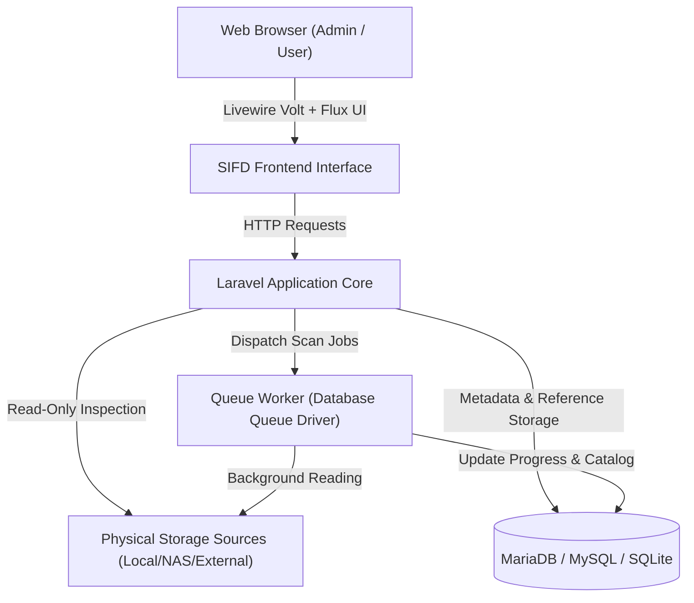

# 🗄️ SIFD - Sistem Inventaris File Digital
### *Centralized Reference-Based Digital File Inventory & Discovery System*

[](https://laravel.com)
[](https://livewire.laravel.com)
[](https://tailwindcss.com)
[](https://php.net)
[-00D084?style=for-the-badge)](https://pestphp.com)
[](#-prinsip-read-only-guarantee)

---

**SIFD (Sistem Inventaris File Digital)** adalah aplikasi katalog dan penemuan file digital terpusat yang dirancang untuk menginventarisasi, mengindeks, mengkategorisasikan, dan melacak file yang tersebar di berbagai media penyimpanan (Local Disk, External Storage, NAS, Network Share) secara otomatis dan berkinerja tinggi.

> [!IMPORTANT]
> **Aplikasi ini adalah sistem katalog dan pencarian referensi, BUKAN sistem penyimpanan file terpusat.**  
> File asli tetap berada di lokasi fisik aslinya. Database bertindak sebagai sumber kebenaran otoritatif (*authoritative source*) untuk metadata inventaris.

---

## 📑 Daftar Isi

- [Prinsip Read-Only Guarantee](#-prinsip-read-only-guarantee)
- [Fitur Utama](#-fitur-utama)
- [Arsitektur & Tech Stack](#-arsitektur--tech-stack)
- [Tampilan Antarmuka](#-tampilan-antarmuka)
- [Persyaratan Sistem](#-persyaratan-sistem)
- [Panduan Instalasi](#-panduan-instalasi)
- [Panduan Penggunaan](#-panduan-penggunaan)
  - [Pemindaian Direktori (Scanner)](#1-pemindaian-direktori-scanner)
  - [Manajemen Katalog & Aksi Massal](#2-manajemen-katalog--aksi-massal)
- [Pengujian Otomatis & Kualitas Kode](#-pengujian-otomatis--kualitas-kode)
- [Struktur Proyek](#-struktur-proyek)
- [Lisensi](#-lisensi)

---

## 🛡️ Prinsip Read-Only Guarantee

Keamanan data fisik adalah prioritas nomor satu. Sistem menerapkan aturan **Strict Read-Only Policy**:
* ❌ **TIDAK PERNAH** mengunggah file fisik ke server aplikasi.
* ❌ **TIDAK PERNAH** mengubah isi file asli di storage.
* ❌ **TIDAK PERNAH** memindahkan atau menyalin file asli.
* ❌ **TIDAK PERNAH** menghapus file atau folder asli dari disk/NAS.
* ❌ **TIDAK PERNAH** mengubah nama file asli di filesystem fisik.
* ✅ Operasi edit nama, penggantian kategori, penambahan tag, dan penghapusan data di SIFD **HANYA** memanipulasi metadata di database katalog.

---

## ✨ Fitur Utama

### 1. 📂 Multi-Source Storage Management
- Mendaftarkan banyak lokasi sumber penyimpanan (Local Filesystem, External Harddrive, NAS, Server Storage).
- Status pemantauan ketersediaan (*online/offline/accessible*).
- Kalkulasi total ukuran, jumlah file, dan waktu verifikasi terakhir per storage source.

### 2. ⚡ Background Queue Scanner
- Proses scan berjalan di **Background Queue Worker** tanpa membebani request HTTP atau menyebabkan *timeout*.
- Tombol **Start Queue Worker** langsung dari antarmuka Web UI tanpa perlu membuka terminal atau mengatur cron manual.
- Pemantauan progres pemindaian secara *real-time* (direktori yang sedang aktif dipindai, jumlah file terindeks, file yang dilewati, dan error).
- Notifikasi *Toast* otomatis saat pemindaian dimulai dan selesai.
- Tombol darurat untuk menghentikan (*cancel/stop*) proses pemindaian yang sedang berjalan.

### 3. 🗃️ Digital File Catalog (`/files`)
- **Dual Display Modes**: Tampilan **Tabel** yang padat informasi atau tampilan **Grid** berbasis kartu modern.
- **Pencarian Cepat & Fleksibel**: Cari berdasarkan nama file, ekstensi, tag, path relatif, atau hash checksum SHA-256.
- **Multi-Filter**: Filter berdasarkan kelompok tipe file (Dokumen, Gambar, Video, Audio, Arsip, Source Code, Folder), storage source, dan kategori.
- **Persistent Sorting**: Sortir berdasarkan Nama File, Kategori, Ukuran File, Jumlah Lokasi, atau Waktu Dibuat (ASC/DESC). Preferensi sorting tersimpan aman di cookie dan session.
- **Aksi Massal (Bulk Actions)**:
  - Checkbox per-baris dan checkbox **Pilih Semua** di header tabel.
  - Floating Bulk Action Bar interaktif.
  - Ubah kategori untuk seluruh file terpilih sekaligus.
  - Hapus data file terpilih dari katalog database dengan dialog konfirmasi aman.
- **Rename Nama Tampilan Katalog**: Mengubah nama file yang tampil di katalog untuk kemudahan identifikasi tanpa menyentuh nama fisik file di disk.
- **Multi-Location Tracking**: Satu entitas file unik (berdasarkan hash SHA-256) dapat melacak beberapa lokasi fisik duplikat secara presisi.

### 4. 🏷️ Kategori & Tagging Cerdas
- Klasifikasi file ke dalam kategori dengan hierarki yang jelas.
- Tag warna-warni untuk pengelompokan lintas kategori.

### 5. 🔐 Keamanan Tingkat Enterprise
- Autentikasi berbasis **Laravel Fortify**.
- Dukungan **Passkeys (WebAuthn / FIDO2 / Biometrik)**.
- **Two-Factor Authentication (2FA / TOTP)** dengan kode QR dan *recovery codes*.
- Proteksi otorisasi menggunakan **Laravel Policies**.

### 6. 🎨 Desain Modern & Responsif
- Dirancang menggunakan warna identitas **Deep Ocean Blue & Vibrant Cyan** yang profesional.
- Mendukung penuh **Light Mode & Dark Mode** dengan deteksi tema otomatis sistem atau preferensi pengguna di dashboard.
- Dibangun dengan **Flux UI** dan **Tailwind CSS v4**.

---

## 🏗️ Arsitektur & Tech Stack



| Layer | Teknologi |
|---|---|
| **Framework** | [Laravel 12 / 13](https://laravel.com) |
| **Reactivity** | [Livewire 4](https://livewire.laravel.com) & [Livewire Volt](https://livewire.laravel.com/docs/volt) |
| **UI Components** | [Flux UI](https://fluxui.dev) & [Blaze Optimizer](https://github.com/livewire/blaze) |
| **Styling** | [Tailwind CSS v4](https://tailwindcss.com) |
| **Database** | MariaDB / MySQL / SQLite (Menggunakan UUID untuk entitas inventaris) |
| **Autentikasi** | Laravel Fortify, Passkeys (WebAuthn), 2FA |
| **Testing** | Pest PHP v4 |
| **Static Analysis** | PHPStan (Larastan) Level 0 errors & Laravel Pint |

---

## 💻 Persyaratan Sistem

- **PHP**: `^8.3` atau lebih baru
- **Ekstensi PHP**: `pdo`, `pdo_mysql` / `pdo_sqlite`, `mbstring`, `fileinfo`, `openssl`, `curl`
- **Node.js**: `^20.x` atau `^22.x` & NPM
- **Composer**: `^2.x`
- **Database**: MariaDB 10.5+, MySQL 8.0+, atau SQLite 3.35+

---

## 🚀 Panduan Instalasi

### 1. Clone Repositori
```bash
git clone https://github.com/username/sifd.git
cd sifd
```

### 2. Instal Dependensi PHP & JavaScript
```bash
composer install
npm install
```

### 3. Salin File Konfigurasi Environment
```bash
cp .env.example .env
php artisan key:generate
```

### 4. Konfigurasi Database di `.env`
Sesuaikan pengaturan koneksi database (contoh MariaDB / MySQL):
```env
DB_CONNECTION=mysql
DB_HOST=127.0.0.1
DB_PORT=3306
DB_DATABASE=sifd_db
DB_USERNAME=root
DB_PASSWORD=secret

QUEUE_CONNECTION=database
```

### 5. Jalankan Migrasi Database
```bash
php artisan migrate --seed
```

### 6. Kompilasi Aset Frontend
```bash
# Untuk mode pengembangan (development)
npm run dev

# Atau untuk mode produksi (production build)
npm run build
```

### 7. Jalankan Server Aplikasi
```bash
php artisan serve
```
Akses aplikasi melalui browser di: `http://localhost:8000`

---

## 📖 Panduan Penggunaan

### 1. Pemindaian Direktori (Scanner)
1. Buka menu **Sumber Penyimpanan** (`/storage-sources`) dan daftarkan direktori yang ingin diinventarisasi (misal: `D:\Documents` atau `/mnt/nas/archives`).
2. Masuk ke menu **Pindai Direktori** (`/scanner`).
3. Jika antrean belum aktif, klik tombol **Start Queue Worker** di bagian atas.
4. Pilih sumber penyimpanan dan opsi pemindaian (rekursif, hitung hash SHA-256, atau abaikan file tersembunyi), lalu klik **Mulai Pindai**.
5. Anda dapat memantau pergerakan direktori yang sedang dipindai secara langsung. Anda juga dapat menekan **Hentikan Pemindaian** kapan saja.

### 2. Manajemen Katalog & Aksi Massal
1. Masuk ke menu **Semua File** (`/files`).
2. Gunakan bar pencarian atau filter tipe file/kategori untuk menemukan file tertentu.
3. Untuk mengubah nama tampilan katalog, klik tombol opsi (**...**) pada baris file, lalu pilih **Ubah Nama Tampilan**.
4. Untuk tindakan massal:
   - Centang checkbox di header tabel untuk memilih seluruh file di halaman saat ini, atau centang beberapa file pilihan.
   - Pilih kategori baru pada dropdown di **Floating Action Bar**, lalu klik **Terapkan**.
   - Atau klik **Hapus Semua Terpilih** untuk menghapus record dari katalog tanpa menyentuh file asli di disk.

---

## 🧪 Pengujian Otomatis & Kualitas Kode

Proyek ini dilengkapi pengujian otomatis yang komprehensif menggunakan **Pest PHP** untuk memastikan keandalan sistem dan konsistensi Read-Only Policy.

### Menjalankan Seluruh Test Suite
```bash
php artisan test
# Atau via binary Pest langsung:
vendor/bin/pest
```

### Pengujian Read-Only Guarantee Spesifik
```bash
vendor/bin/pest tests/Feature/InventoryPagesTest.php
```

### Analisis Statis Kode (PHPStan)
```bash
vendor/bin/phpstan analyse --memory-limit=512M
```

### Pengecekan Gaya Format Kode (Pint)
```bash
vendor/bin/pint --test
```

---

## 📁 Struktur Proyek

```text
sifd/
├── app/
│   ├── Actions/Fortify/           # Alur autentikasi, registrasi & profil Fortify
│   ├── Enums/                     # Enum tipe file & status scanner
│   ├── Jobs/                      # Job background queue pemindaian direktori
│   ├── Models/                    # Model Eloquent (InventoryFile, StorageSource, Category, dll.)
│   ├── Policies/                  # Kebijakan otorisasi data inventaris
│   └── Services/                  # Business logic (DirectoryScannerService, InventoryFileService)
├── database/
│   ├── migrations/                # Skema database relasional MariaDB/MySQL
│   └── seeders/                   # Data awal kategori & tag default
├── resources/
│   ├── css/                       # Gaya Tailwind CSS kustom & tema Ocean Blue
│   ├── js/                        # Modul JavaScript & Passkeys WebAuthn
│   └── views/
│       ├── components/            # Komponen Blade reusable
│       ├── layouts/               # Template layout dashboard & guest
│       └── pages/                 # Komponen Livewire Volt (Dashboard, Files, Scanner, Settings)
├── routes/
│   ├── web.php                    # Definisi rute utama web
│   └── settings.php               # Rute pengaturan profil & keamanan
└── tests/
    └── Feature/                   # Pengujian integrasi Pest PHP (68+ tests passing)
```

---

## 📄 Lisensi

Aplikasi ini dilisensikan di bawah lisensi terbuka [MIT License](LICENSE).  
Hak Cipta © 2026 **SIFD Team**.

